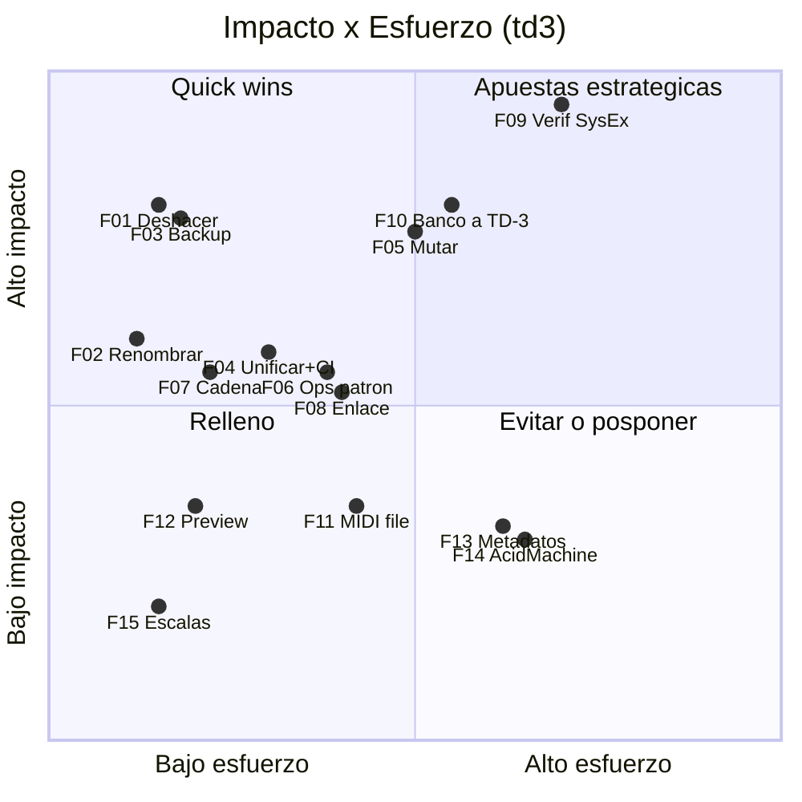

# td3: oportunidades de producto

Fecha: 2026-11-21 · Alcance: `tools/app-td-3` (paquete Python `td3`, skill `td3-patterns` y PWA `web/`).

Este documento separa tres tipos de afirmación, marcadas así:

- **[E] Evidencia:** está en el código, los docs o los tests del repo (con ruta).
- **[H] Hipótesis:** inferencia razonable que nadie validó con el usuario.
- **[R] Recomendación:** lo que propongo hacer.

No hay analytics, entrevistas ni feedback de usuarios. Todas las necesidades de usuario son **[H]** salvo que se cite su origen.

---

## 1. Qué es el producto

**[E]** td3 genera, edita y exporta patrones ácidos para el Behringer TD-3 (clon de la TB-303). Lo pidió el perfil profesional del dueño (`raw/2026-11-21-perfil-ia-profesional.md` §2 ítem 2). Tiene dos superficies que comparten el contrato **Bank v1** (`docs/SPEC.md`): un banco de 4 variaciones A–D de 16 pasos cada una.

| Superficie | Quién decide la música | Salida | Dónde corre |
|---|---|---|---|
| Escritorio: skill `td3-patterns` + CLI Python | El agente (Claude Code), ADR-0002 | `bank.json` validado → 4 `.seq` | Máquina local / Termux |
| Móvil: PWA `web/` | Generador determinista TS con semilla (ADR-0006) | `.seq` ×4, `.json`, SysEx experimental | Chrome Android, offline |

**Arquitectura [E]:** tres capas. La de decisión (agente o generador) produce solo JSON; la determinista (codec puro, `codec.py` / `codec.ts`) produce bytes; el transporte MIDI va aparte y es opcional (ADR-0003). El codec TS es un port 1:1 del Python, y los tests TS leen los fixtures y el schema del paquete Python para garantizar paridad (ADR-0006).

### Estado de madurez

| Hito | Estado [E] (`README.md`) |
|---|---|
| M0 bytes reales | ✅ 3 `.seq` reales de SynthTribe |
| M1 dominio/CLI | ✅ |
| M2 codec | ✅ `.seq` verificado byte a byte; SysEx **sin verificar en hardware** |
| M3 transporte USB | ⛔ Bloqueado: falta un TD-3 conectado por USB |
| M4 skill | Parcial |
| M5 PWA | ✅ con MIDI experimental |

**[E]** Calidad: 66 tests Python y 74 tests TS en verde (corridos hoy). Hay gate de calidad documentado (ruff, mypy strict, eslint, tsc). No hay tests de la UI (`app.tsx`, 406 líneas), y solo existe CI para publicar Pages a mano (`.github/workflows/td3-web-pages.yml`); no corre nada en push ni en PR.

**Diagnóstico:** el núcleo (contrato, codec, generador) es sólido y está bien testeado. La capa de experiencia (gestión de bancos, edición, entrega al equipo) es la parte inmadura. El cuello de botella del producto es la **última milla al hardware**: hoy todo termina en "cargalo en SynthTribe".

---

## 2. Inventario de funcionalidades existentes

| # | Funcionalidad | Evidencia |
|---|---|---|
| 1 | Validación estructural de Bank v1 con errores por ruta JSON | `src/td3/domain.py`, `td3 validate`; `web/src/domain.ts` |
| 2 | JSON Schema exportable y sincronizado por test | `td3 schema`, `src/td3/bank.schema.json` |
| 3 | Grilla ASCII de los 4 patrones | `td3 show` |
| 4 | Export `.seq` ×4 (firmware 1.3.7) verificado byte a byte | `td3 export`, `codec.py`, `web/src/io.ts` |
| 5 | Import `.seq` → Pattern (incluye `length` y `triplet`) | `td3 import`, `decodeSeq` |
| 6 | Generación por intención vía agente | `.claude/skills/td3-patterns/SKILL.md` |
| 7 | Generador local determinista: tónica, 4 escalas, 3 estilos, densidad, semilla | `web/src/generator.ts` (`SCALES`, `STYLES`, `rng`) |
| 8 | Variaciones B (acentos), C (slides/ties), D (octavas/gates) derivadas de A | `varyAccents`, `varySlidesTies`, `varyOctavesGates` |
| 9 | Editor de pasos: gate, nota, octava, accent, slide; `length` y tresillo por patrón | `app.tsx` (sección `.editor`) |
| 10 | Preview de audio estilo 303 (saw → lowpass → VCA, slide, accent) con BPM y cutoff | `web/src/synth.ts` |
| 11 | Bancos guardados en `localStorage`, listar, abrir, borrar | `web/src/storage.ts` |
| 12 | Compartir archivos (Web Share → Drive/Telegram) o descargarlos | `deliver()` en `io.ts` |
| 13 | Import en la PWA de `.json` (reemplaza el banco) o `.seq` (reemplaza el patrón activo) | `importFile()`, `onImport` |
| 14 | Envío SysEx por Web MIDI (experimental, con flag y confirmación, muestra el hex) | `web/src/midi.ts`, `midi-panel.tsx` |
| 15 | PWA instalable y offline; publicación opcional en Pages | `vite.config.ts`, workflow |
| 16 | Preferencias persistidas: opciones de generación y BPM | `getPref`/`setPref` |

---

## 3. Perfiles de usuario

| Perfil | Base | Trabajo a realizar (JTBD) |
|---|---|---|
| **P1. Productor en el escritorio** (el dueño) | **[E]** skill + CLI; perfil: acid techno, hard techno, rominimal | "Cuando quiero una línea nueva con un carácter concreto, quiero describirla en palabras y tenerla en el TD-3, para tocar en lugar de programar paso a paso." |
| **P2. Productor con el teléfono / en la jam** (el dueño) | **[E]** ADR-0006, Termux, perfil (Poco X7 como terminal) | "Cuando estoy con el TD-3 y sin PC, quiero generar, retocar y escuchar variaciones y pasarlas al equipo, para no cortar el flujo." |
| **P3. Otros dueños de TD-3** | **[H]** solo por el perfil §5 estrategia 2 ("Web-App Zero-Backend Hardware Audio", pago único). Ningún usuario externo validado | "Quiero programar el TD-3 sin pelearme con su secuenciador." |

**Necesidades [H] que siguen de esos JTBD:**

1. Que el patrón **llegue al equipo** con el menor número de pasos posible (P1, P2). El README ya registra la fricción **[E]**: hoy hay que cargar cada `.seq` por separado en SynthTribe, que corre en una PC.
2. **No perder trabajo**: las ediciones son lo que tiene valor, no la semilla (P2).
3. **Iterar rápido** sobre algo que ya suena bien, sin empezar de cero (P1, P2).
4. Escuchar las 4 variaciones **como se tocarían en vivo** (P2).

P3 queda fuera de la priorización hasta que haya alguna señal de demanda (ver §8).

---

## 4. Huecos, fricciones y oportunidades detectadas

### Fricciones UX con evidencia en el código

| ID | Fricción | Evidencia [E] |
|---|---|---|
| X1 | **Generar** reemplaza el banco sin preguntar y descarta las ediciones no guardadas | `doGenerate()` llama a `setBank(generate(o))` sin chequear cambios |
| X2 | Importar un `.json` reemplaza el banco entero sin confirmar | `onImport` → `setBank(r.bank)` |
| X3 | No hay deshacer: un toque equivocado en la grilla no se revierte | `updateBank` muta y no guarda historial |
| X4 | El nombre del banco no se puede editar y `saveBank` lo usa como clave: guardar un banco con el mismo nombre (misma tónica, escala, estilo y semilla) **pisa en silencio** al anterior | `saveBank()` hace `{...readAll(), [bank.name]: bank}`; no hay input de nombre en `app.tsx` |
| X5 | Los bancos viven solo en `localStorage`. Si se borran los datos del sitio o se reinstala la PWA, se pierden todos. No hay export masivo | `storage.ts` |
| X6 | El generador produce el banco entero o nada: no se puede regenerar una sola variación ni mutar un patrón editado | `generate()` es la única entrada |
| X7 | El preview reproduce un solo patrón en loop; no hay forma de escuchar A→B→C→D | `synth.pattern = pattern` |
| X8 | Resonancia fija (12) y cutoff sin persistir; BPM y knobs no viajan en el banco ni en el `.seq` | `synth.ts`, `app.tsx`; README del handoff |

### Flujos incompletos

| ID | Flujo | Evidencia [E] |
|---|---|---|
| G1 | **Envío al hardware:** SysEx implementado pero sin verificar; M3 bloqueado. El README lista los 3 pasos de verificación, pero la app no tiene herramientas para hacerlos (no recibe MIDI, no compara) | `README.md` §MIDI USB, `midi.ts` (solo output) |
| G2 | Enviar un banco = 4 envíos manuales con slot elegido a mano | `midi-panel.tsx` |
| G3 | El patrón no sale hacia un DAW (no hay MIDI file) | sin código |

### Deuda que frena la evolución

| ID | Deuda | Evidencia [E] |
|---|---|---|
| D1 | Hay **dos copias** del paquete: `tools/td3` y `tools/app-td-3`, ambas versionadas. Las skills apuntan a `tools/td3`, el README de `app-td-3` dice `cd tools/td3` y el handoff de AcidMachine vive solo en `tools/td3`. Cualquier cambio de contrato hay que hacerlo dos veces | `diff -rq` entre ambas carpetas |
| D2 | Sin CI en push/PR: la paridad Python↔TS se verifica solo si alguien corre los tests | `.github/workflows/` |

---

## 5. Mercado y productos comparables

| Producto | Qué ofrece | Lectura para td3 |
|---|---|---|
| [AudioPump TD-3 Pattern Tool](https://www.gearnews.com/control-your-acid-with-the-td-3-pattern-tool-sequence-editor/) | Editor web gratuito, grilla de 16 pasos, envío por Web MIDI | El envío directo por navegador es el estándar esperado; td3 lo tiene experimental |
| [TDminator (discoDSP)](https://www.synthtopia.com/?p=155625) | Editor de pago con control SysEx completo, generador aleatorio y sintetizador por software | Valida la combinación generador + edición + envío. Es de pago y de escritorio |
| [Acid Injector](https://echolevel.github.io/Acid-Injector) | Convierte MIDI en `.seq` y `.syx` | Lo que hace hoy td3, pero sin generación |
| [SynthTribe](https://apps.apple.com/us/app/synthtribe/id1487038242) | App oficial con programador de secuencias; un comentario de usuario lo califica de pobre | Es el paso obligado actual de td3, y es el más débil |
| [Bassliner](https://apps.apple.com/us/app/bassliner/id1566713961) | Programador de TD-3 para iPad | No hay equivalente claro en Android **[H]** |
| [The Endless Acid Banger](https://www.musictech.net/news/randomised-algorithmic-acid-music-vitlings-the-endless-acid-banger-909-303/) | Generación algorítmica continua, *autopilot* que decide qué mutar, sin entrada manual | Patrón: **mutar incrementalmente** en lugar de regenerar todo |
| [AcidLines](https://www.github.com/maximecb/acidlines) | Secuenciador web por Web MIDI para clones 303; en su roadmap: encadenar patrones en un track | Patrón: **cadena de patrones** |
| [BT 303 Pocket](https://apps.apple.com/us/app/-/id6732860204) | iOS; agregó selector de tonalidad y modo para aleatorizar | Valida generar por escala, que td3 ya tiene |

**Lectura estratégica:**

- **Lo que td3 tiene y es raro:** offline en Android, reproducibilidad por semilla, 4 variaciones relacionadas en lugar de un solo random, `.seq` verificado byte a byte, y una puerta de entrada por lenguaje natural vía agente.
- **Lo que falta y el mercado da por hecho:** envío directo y confiable al equipo.
- **Trampa a evitar:** sumar drum machine, más sintes o un DAW en miniatura por paridad con Acid Banger o TDminator. Nada en el repo indica que el dueño lo necesite.

---

## 6. Features propuestas (15)

Escalas: **Impacto** 1–5 · **Esfuerzo** S (≤ medio día), M (1–3 días), L (> 3 días o bloqueado por hardware) · **Confianza** en la estimación: Alta / Media / Baja.

### F01. Protección de ediciones y deshacer
- **Problema:** X1, X2 y X3. Un toque en *Generar* o *Importar* borra el trabajo manual sin aviso.
- **Beneficio:** editar sin miedo, que es la base para iterar.
- **Prioridad:** Alta. Es pérdida de datos real, con evidencia en el código y costo bajo.
- **Complejidad:** S. Un flag `dirty` más una pila de bancos anteriores (los bancos son chicos y `cloneBank` ya existe).
- **Dependencias:** solo `app.tsx`.
- **Aceptación:** (a) con cambios sin guardar, *Generar* e *Importar .json* piden confirmación; (b) *Deshacer* revierte la última edición de paso, `length`, `triplet`, generación o importación; (c) al menos 20 niveles; (d) test unitario del reductor de historial.

### F02. Renombrar y "guardar como"
- **Problema:** X4. Un banco puede pisar a otro en silencio, y los nombres generados no dicen nada del contenido.
- **Beneficio:** una biblioteca propia legible ("bajo-intro-viernes").
- **Prioridad:** Alta. Riesgo de pérdida de datos y esfuerzo mínimo.
- **Complejidad:** S. Input validado con `NAME_RE`/`NAME_MAX` (ya existen en `domain.ts`).
- **Dependencias:** `storage.ts`, `domain.ts`.
- **Aceptación:** (a) se puede editar el nombre y un nombre inválido muestra el error de `parseBank`; (b) guardar con un nombre que ya existe pide confirmación para sobrescribir; (c) "Duplicar" crea `<nombre>-2`.

### F03. Backup y restauración de la biblioteca
- **Problema:** X5. Toda la biblioteca depende de `localStorage`.
- **Beneficio:** pasar los bancos a otro teléfono o al repo (escritorio) y sobrevivir a una reinstalación.
- **Prioridad:** Alta. El costo de perder la biblioteca es alto y la solución reusa `deliver()`.
- **Complejidad:** S. Un JSON `{version, banks: Bank[]}` validado banco por banco con `parseBank`.
- **Dependencias:** `io.ts`, `storage.ts`. Opcionalmente, `td3 validate` podría aceptar ese formato (no es necesario).
- **Aceptación:** (a) "Exportar biblioteca" entrega un archivo con todos los bancos; (b) importarlo en un navegador limpio restaura N bancos idénticos (test de ida y vuelta); (c) los bancos inválidos se informan y se saltean, sin abortar el resto.

### F04. Unificar `tools/td3` y `tools/app-td-3`, con CI en push
- **Problema:** D1 y D2. Doble mantenimiento y paridad sin vigilancia.
- **Beneficio:** indirecto, pero cualquier feature que toque el contrato cuesta la mitad.
- **Prioridad:** Alta como habilitador. Hacerlo antes que F09 y F14.
- **Complejidad:** S–M. Mover el handoff, actualizar las rutas de las dos skills y del README, borrar la copia, y un workflow que corra el gate Python y el TS.
- **Dependencias:** skills `td3-patterns` y `td3-seq-patterns`, `.github/workflows`.
- **Aceptación:** (a) existe una sola carpeta del paquete; (b) `grep -r "tools/td3/" .claude` no devuelve rutas rotas; (c) un push que rompa la paridad TS↔Python deja el CI en rojo.

### F05. Regenerar una variación y "mutar" la actual
- **Problema:** X6. Si A suena bien pero D no, hoy hay que regenerar todo y se pierde A.
- **Beneficio:** iterar sobre lo que ya funciona (el patrón *autopilot* de Acid Banger, a escala chica).
- **Prioridad:** Alta. Es el corazón del flujo creativo en el teléfono **[H]**, y el generador ya tiene las piezas (`varyAccents` y siguientes).
- **Complejidad:** M. Exponer `regenerate(bank, key, opts, seed)` y `mutate(pattern, amount, seed)` reutilizando las funciones de variación. Sigue siendo determinista.
- **Dependencias:** `generator.ts`. ADR-0002 rechazó un motor de mutaciones *en Python* "salvo que aparezca la necesidad de mutar bancos existentes". Esto lo cubre en la PWA; conviene una nota en el ADR-0006.
- **Aceptación:** (a) "Regenerar D" cambia solo D; (b) "Mutar" sobre un patrón editado conserva la cantidad de pasos activos ±1 y la tónica en el paso 1; (c) misma entrada y misma semilla dan el mismo resultado (test); (d) se integra con deshacer (F01).

### F06. Operaciones de patrón: transponer, rotar, copiar entre slots y limpiar
- **Problema:** editar paso a paso es lento para cambios globales: subir todo un semitono, correr el groove un paso, copiar A en B para variarlo a mano.
- **Beneficio:** edición de alto nivel con pocos toques.
- **Prioridad:** Media. Son operaciones estándar en secuenciadores **[H]**. Su valor depende de cuánto edite el usuario a mano.
- **Complejidad:** S–M. Funciones puras sobre `Pattern` y `normalize`.
- **Dependencias:** `domain.ts` o un módulo nuevo `ops.ts`; F01.
- **Aceptación:** (a) transponer ±1 semitono pasa B→C con octava +1 y no deja ninguna nota fuera del rango representable (si quedaría, la operación avisa y no aplica); (b) rotar 16 veces devuelve el original; (c) copiar A→B produce un B idéntico; (d) tests unitarios de cada operación.

### F07. Escuchar la cadena A→B→C→D
- **Problema:** X7. Las variaciones se piensan para alternarse, pero solo se escuchan aisladas.
- **Beneficio:** juzgar el banco como se tocaría en vivo.
- **Prioridad:** Media. Bajo costo, mejora el juicio musical **[H]**. AcidLines lo tiene en su roadmap.
- **Complejidad:** S. `AcidSynth` avanza `pattern` al terminar `length` pasos según una lista de claves.
- **Dependencias:** `synth.ts`, `app.tsx`.
- **Aceptación:** (a) el modo "Cadena" reproduce A, B, C y D respetando el `length` de cada uno, sin cortes audibles en el cambio; (b) la pestaña activa sigue al patrón que suena; (c) se puede elegir el orden o repetir (por ejemplo AABA).

### F08. Compartir un banco por enlace
- **Problema:** pasar un banco a otro dispositivo o persona exige un archivo.
- **Beneficio:** un link por Telegram que abre la PWA con el banco cargado, sin backend.
- **Prioridad:** Media. Encaja con la arquitectura *zero-backend* del perfil (Blueprint A usa estado en la URL).
- **Complejidad:** S–M. Serializar el banco en compacto (por ejemplo 2 bytes por paso en base64url, dentro del fragmento `#`) y validarlo con `parseBank` al abrir.
- **Dependencias:** `domain.ts`, `io.ts`. El sitio tiene que estar publicado (Pages) para que el link sirva fuera del teléfono propio.
- **Aceptación:** (a) "Copiar enlace" genera una URL de menos de 300 caracteres; (b) abrirla carga un banco idéntico (test de ida y vuelta); (c) un fragmento corrupto muestra un error y no pisa el banco actual.

### F09. Kit de verificación SysEx en hardware (desbloquea M3)
- **Problema:** G1. El envío directo, que es lo que el mercado da por hecho, está implementado pero no se puede confiar en él. Los 3 pasos de verificación del README son manuales y la app no ayuda.
- **Beneficio:** convertir "experimental" en una función confiable con una sola sesión con el equipo.
- **Prioridad:** **La más alta en valor estratégico.** Elimina el paso por SynthTribe y la PC. La confianza es baja porque depende del hardware y del protocolo real.
- **Complejidad:** M (más el acceso al TD-3). Escuchar entradas Web MIDI, capturar el SysEx que llega (dump hecho desde el equipo o desde SynthTribe), decodificarlo, mostrar un diff contra `encodeSysex` del mismo patrón y slot, y exportar la captura como fixture.
- **Dependencias:** `midi.ts` (agregar inputs), `codec.ts`/`codec.py` (decoder SysEx), ADR-0003. Requiere el TD-3 por USB.
- **Aceptación:** (a) con el TD-3 conectado, la app captura al menos un dump y lo guarda como `.syx`; (b) ese `.syx` entra como fixture y un test compara `encodeSysex` contra él byte a byte; (c) queda documentado en `FORMAT.md` si los slots son 0–7 o 8–15; (d) si el diff da 0, ADR nuevo para quitar el flag.

### F10. Enviar el banco completo al TD-3 (A–D en 4 slots)
- **Problema:** G2. Hoy son 4 envíos con slot elegido a mano y una confirmación cada uno.
- **Beneficio:** del teléfono al equipo en un toque.
- **Prioridad:** Media-alta, pero **condicionada a F09**.
- **Complejidad:** S una vez verificado el SysEx (un loop con pausa entre mensajes).
- **Dependencias:** F09.
- **Aceptación:** (a) "Enviar banco a grupo N, slots 1–4" escribe las 4 variaciones con una sola confirmación; (b) verificado en hardware: los 4 patrones suenan iguales que en el preview; (c) si un envío falla, se informa cuál.

### F11. Exportar MIDI file (`.mid`)
- **Problema:** G3. El patrón no sale hacia un DAW ni hacia otros 303 (software o clones).
- **Beneficio:** el patrón sirve fuera del TD-3, por ejemplo para grabar o arreglar en un DAW. También abre un camino alternativo vía herramientas como Acid Injector.
- **Prioridad:** Media-baja. Útil pero no está en el JTBD central **[H]**; el perfil menciona DAW solo de forma indirecta.
- **Complejidad:** S–M. SMF tipo 0 escrito a mano (accent → velocity, slide → solape legato, tie → nota extendida). No hace falta una librería.
- **Dependencias:** un módulo nuevo `midifile.ts`, `io.ts`.
- **Aceptación:** (a) exporta 1 archivo por patrón o 1 con los 4 en secuencia; (b) abierto en un DAW, las notas y duraciones coinciden con la grilla (test que decodifica el SMF y compara contra el Pattern); (c) el `length` se respeta.

### F12. Preview más fiel y knobs guardados
- **Problema:** X8. Con resonancia fija y sin env mod ni decay, el preview no se parece al TD-3. Además el cutoff se pierde al recargar.
- **Beneficio:** decidir mejor antes de pasar el patrón al equipo.
- **Prioridad:** Baja-media. El preview es una guía; su fidelidad no está pedida en ningún lado **[H]**.
- **Complejidad:** S. Exponer `resonance`, env mod y decay (los parámetros ya existen dentro de `AcidSynth`) y persistirlos con `setPref`.
- **Dependencias:** `synth.ts`, `app.tsx`.
- **Aceptación:** (a) los controles reso, env mod y decay modifican el sonido en tiempo real; (b) sobreviven a recargar la página; (c) no hay clicks ni cortes al moverlos durante la reproducción.

### F13. Metadatos de performance en el banco (BPM y knobs sugeridos)
- **Problema:** **[E]** el BPM y los mandos no viajan en el `.seq` (README del handoff de AcidMachine), y Bank v1 prohíbe campos extra (`extra="forbid"`). La intención del banco se pierde al reabrirlo.
- **Beneficio:** un banco reabierto o compartido suena como cuando se creó.
- **Prioridad:** Baja. Cambia el contrato, y eso se hace solo si F12 y F08 lo vuelven necesario.
- **Complejidad:** M. Un campo opcional `performance: {bpm, cutoff, resonance, ...}` en Bank (v1 compatible) con un ADR, el modelo Python, el schema, la skill y el TS.
- **Dependencias:** F04 (una sola copia del contrato), ADR nuevo.
- **Aceptación:** (a) los bancos v1 viejos siguen validando; (b) un banco con `performance` se abre con esos valores en el preview; (c) el schema y el test de sincronía se actualizan; (d) `td3 validate` lo acepta.

### F14. Importar notación AcidMachine en la PWA
- **Problema:** la conversión de la notación AcidMachine (`note/oct/as/tm`) existe solo en el escritorio (skill `td3-seq-patterns`, `acid2seq.py`).
- **Beneficio:** estudiar y variar líneas clásicas también desde el teléfono.
- **Prioridad:** Baja. El valor depende de cuánto use el dueño ese catálogo **[H]**. **No hay que empaquetar los 26 patrones de terceros en la app**: son transcripciones con sus propios términos (README del handoff). Solo importar archivos que el usuario ya tenga.
- **Complejidad:** M. Portar a TS las reglas de `acid2seq.py` (`tm=2`, `tm=0`, C aguda) con tests de paridad contra la salida Python.
- **Dependencias:** F04 (el handoff tiene que estar en la carpeta unificada).
- **Aceptación:** (a) importar un `*.original.json` produce el mismo Pattern que `acid2seq.py` (test de paridad); (b) los avisos (octava bajada, C aguda recortada) se muestran en la UI.

### F15. Escalas y estilos adicionales como datos
- **Estado (2026-11-21):** se agregaron los estilos Jungle, Phonk, House y Dreamy en `STYLES` (`web/src/generator.ts`), calibrados con guías de producción y, en house, con los patrones de AcidMachine. Faltan escalas nuevas. Con densidad ≤ 50 % el generador llenaba solo pasos pares, así que los slides y ties del estilo no se aplicaban. **Resuelto:** cada estilo puede definir `order`, la prioridad con que se llenan las posiciones; los cuatro estilos nuevos usan pares contiguos y house prioriza contratiempos. Los estilos anteriores generan los mismos bancos que antes. El acento también depende del estilo: el campo `strongAccent` controla el acento en tiempos fuertes, en el paso 1 y en la nota de color, y además modera a B. Proporción de pasos `on` con acento en A: jungle 0.11, phonk 0.20, house 0.16, dreamy 0.10; acid techno sigue en ≈ 0.57.
- **Problema:** **[E]** hay 4 escalas y 3 estilos fijos en el código. **[H]** El perfil menciona hard techno, que no tiene perfil propio.
- **Beneficio:** más rango expresivo sin tocar el algoritmo.
- **Prioridad:** Baja. Es la feature con más riesgo de paridad por paridad. Conviene hacerla solo cuando el dueño pida un estilo concreto.
- **Complejidad:** S. Son entradas nuevas en `SCALES` y `STYLES`; el tipado ya lo permite.
- **Dependencias:** `generator.ts`; mantener sincronizada la tabla de la skill.
- **Aceptación:** (a) cada escala nueva tiene un test que verifica que todas las notas generadas pertenecen a ella; (b) cada estilo nuevo tiene un test de densidad igual al del resto.

---

## 7. Priorización

### Tabla priorizada

| Rank | ID | Feature | Impacto | Esfuerzo | Confianza | Grupo |
|---|---|---|---|---|---|---|
| 1 | F01 | Protección de ediciones y deshacer | 4 | S | Alta | Quick win |
| 2 | F03 | Backup y restauración de la biblioteca | 4 | S | Alta | Quick win |
| 3 | F02 | Renombrar y "guardar como" | 3 | S | Alta | Quick win |
| 4 | F04 | Unificar carpetas y CI en push | 3 (habilitador) | S–M | Alta | Quick win |
| 5 | F09 | Kit de verificación SysEx | 5 | M + hardware | Baja | MVP |
| 6 | F05 | Regenerar variación y mutar | 4 | M | Media | MVP |
| 7 | F07 | Escuchar cadena A→D | 3 | S | Media | Quick win |
| 8 | F10 | Enviar banco completo al TD-3 | 4 | S (tras F09) | Baja | MVP |
| 9 | F06 | Operaciones de patrón | 3 | S–M | Media | MVP |
| 10 | F08 | Compartir por enlace | 3 | S–M | Media | MVP |
| 11 | F12 | Preview más fiel y knobs guardados | 2 | S | Media | Evolución |
| 12 | F11 | Exportar `.mid` | 2 | S–M | Media | Evolución |
| 13 | F13 | Metadatos de performance | 2 | M | Media | Evolución |
| 14 | F14 | Importar notación AcidMachine en la PWA | 2 | M | Baja | Evolución |
| 15 | F15 | Escalas y estilos adicionales | 1–2 | S | Media | Evolución |

La confianza de **impacto** es en general Media-Baja, porque no hay datos de uso. La de **esfuerzo** es Alta en todo lo que es puro TS/Python y Baja en todo lo que toca hardware.

### Matriz Impacto × Esfuerzo

| | Bajo esfuerzo | Alto esfuerzo |
|---|---|---|
| **Alto impacto** | F01, F03, F02, F04, F07 | F09, F10, F05 |
| **Bajo impacto** | F12, F15 | F11, F13, F14 |

---

## 8. Roadmap recomendado

### Quick wins (≈ 1 semana de ratos libres): "no perder nada"
F01 deshacer → F02 renombrar → F03 backup → F04 unificar + CI → F07 cadena.
**Resultado:** la PWA es segura para trabajar de verdad, y el repo tiene una sola fuente de verdad con paridad vigilada por CI.

### MVP (2–4 semanas): "del teléfono al TD-3 sin PC"
1. **F09** kit de verificación. Planificar una sesión con el TD-3 por USB; es el único bloqueo externo.
2. **F10** banco completo al equipo, si F09 da diff 0.
3. **F05** regenerar y mutar.
4. **F06** operaciones de patrón y **F08** enlace, según cuánto se use la edición manual.

**Resultado:** el JTBD de P2 se cumple de punta a punta. Si F09 falla (el protocolo no coincide), el MVP cae a F05 + F06 + F08 y el `.seq` vía SynthTribe sigue siendo la entrega.

### Evolución futura (con señal de uso)
F12 → F13 (solo si F12 o F08 lo piden) → F11 → F14 → F15.

### Métricas para decidir (sin analytics, a mano)
- Patrones que efectivamente llegan al TD-3 por semana (la tarea W47 "realizar tres patrones con el TD-3" es la primera señal real).
- Ediciones por banco antes de exportar. Si son muchas, F06 sube; si son pocas, F05 importa más que F06.
- Veces que se reabre un banco guardado. Si es alto, F13 sube.

---

## 9. Descartado o aparcado

| Idea | Por qué no ahora |
|---|---|
| `td3 generate` en la CLI (portar el generador a Python) | ADR-0002 define que en escritorio decide el agente. Reabrirlo sin una necesidad concreta duplica lógica |
| Drum machine, segundo sinte o modo DAW | Paridad con Acid Banger o TDminator sin evidencia de necesidad |
| Cuentas, sync en la nube o Supabase | ADR-0001: un solo usuario. F03 y F08 cubren mover bancos sin backend |
| Licencias o cobro (Polar.sh), perfil P3 | No hay ninguna señal de demanda externa. Primero el JTBD propio; después, como experimento barato: publicar en Pages y medir si alguien lo usa |
| Empaquetar el catálogo AcidMachine en la app | Términos de terceros (README del handoff) |
| APK con Capacitor | La PWA ya se instala. Reconsiderarlo solo si Web MIDI en Chrome Android resulta insuficiente en F09 |

## Fuentes externas

- [AudioPump TD-3 Pattern Tool (gearnews)](https://www.gearnews.com/control-your-acid-with-the-td-3-pattern-tool-sequence-editor/)
- [TDminator (Synthtopia)](https://www.synthtopia.com/?p=155625)
- [Acid Injector](https://echolevel.github.io/Acid-Injector)
- [SynthTribe (App Store)](https://apps.apple.com/us/app/synthtribe/id1487038242)
- [Bassliner (App Store)](https://apps.apple.com/us/app/bassliner/id1566713961)
- [The Endless Acid Banger (MusicTech)](https://www.musictech.net/news/randomised-algorithmic-acid-music-vitlings-the-endless-acid-banger-909-303/)
- [AcidLines (GitHub)](https://www.github.com/maximecb/acidlines)
- [BT 303 Pocket (App Store)](https://apps.apple.com/us/app/-/id6732860204)
